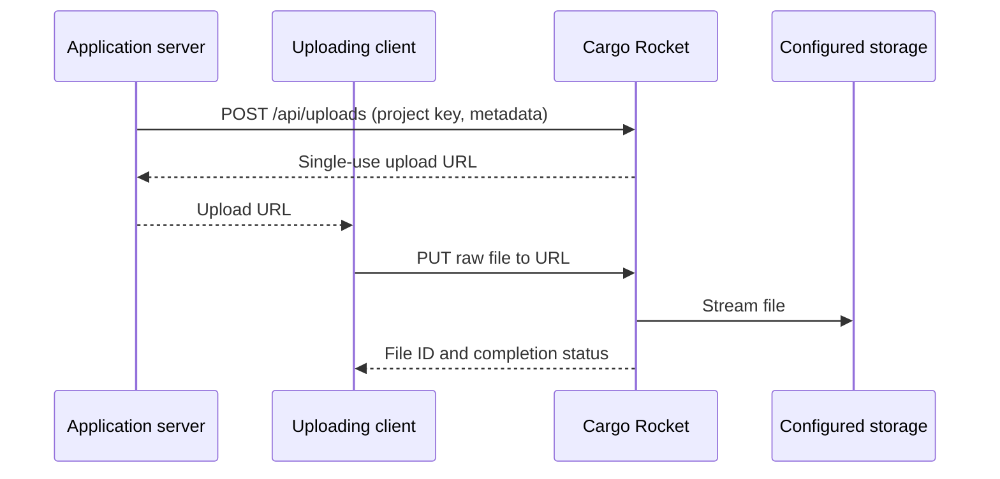

# Cargo Rocket

**One upload API. Your choice of storage.**

[](https://github.com/1338/cargo-rocket/actions/workflows/ci.yml)
[](LICENSE)
[](Cargo.toml)

Cargo Rocket is a small, self-hosted Rust service for sharing upload infrastructure across projects. Request a short-lived upload URL, PUT a file to it, and let the service write it to your configured storage.

Use a local folder, S3-compatible bucket, Azure Blob container, FTP server, or directory over SSH. Each project gets its own API key, file namespace, and upload limits. A built-in dashboard manages connections and project keys.

There is one binary, one SQLite database, and no frontend build step.



Uploads pass through Cargo Rocket, so every backend uses the same flow. This is an **S3-style upload flow**, not an S3 protocol implementation or AWS SDK endpoint.

## Prebuilt binaries

Tagged releases provide Linux x64/ARM64 and macOS Intel/Apple Silicon binaries, with SHA-256 checksums. Download from [GitHub Releases](https://github.com/1338/cargo-rocket/releases) and follow the [binary installation guide](docs/binaries.md). Until the first version tag is published, use source or Docker below. No Rust toolchain is needed to run a prebuilt binary.

## Quick start

Requires Rust 1.89+, a C compiler, and OpenSSL's command-line tool to generate a secret. SSH storage also requires an OpenSSH client. Linux is the tested platform.

```sh
git clone https://github.com/1338/cargo-rocket.git
cd cargo-rocket
export HOST_URL="http://localhost:3000/"
export ADMIN_TOKEN="$(openssl rand -hex 32)"
cargo run --locked
```

1. Open the URL in `HOST_URL` and enter the value of `ADMIN_TOKEN`.
2. Add a **Local disk / folder** connection with an absolute writable path, such as `/tmp/cargo-rocket-files`. Use **Test** to check write, read, and delete access.
3. Create a project using that connection. Save its API key; it is shown only once.
4. Upload a file using the example below.

`HOST_URL` sets the listening hostname/port and the base URL used in upload links. Change it to `http://localhost:8080/` to run on port 8080. A DNS hostname must already resolve to an address on the server; this setting does not create a DNS record. For HTTPS behind a proxy, see [deployment](docs/deployment.md).

For Docker:

```sh
export HOST_URL="http://localhost:3000/"
export ADMIN_TOKEN="$(openssl rand -hex 32)"
docker compose up --build
```

The dashboard is available at the same address. Use `/data/files` as the local connection path inside the container. See [deployment](docs/deployment.md) for persistence, remote storage credentials, and HTTPS.

## Upload a file

This runnable example requires `curl` and `jq`. Use your **project key**, not the admin token.

```sh
export PROJECT_KEY='your-project-api-key'
base_url="${HOST_URL:-http://localhost:3000}"
base_url="${base_url%/}"
printf 'hello' > /tmp/hello.txt

# 1. Request an upload URL for exactly five bytes.
ticket=$(curl --fail-with-body --silent --show-error \
  "$base_url/api/uploads" \
  -H "Authorization: Bearer $PROJECT_KEY" \
  -H 'Content-Type: application/json' \
  -d '{"filename":"hello.txt","content_type":"text/plain","size":5}')

upload_url=$(printf '%s' "$ticket" | jq -er '.upload_url')
file_id=$(printf '%s' "$ticket" | jq -er '.id')

# 2. Upload the raw file. No API key is needed on this request.
curl --fail-with-body --silent --show-error -X PUT "$upload_url" \
  -H 'Content-Type: text/plain' \
  --data-binary @/tmp/hello.txt

# Download with the owning project's API key.
curl --fail-with-body --silent --show-error \
  "$base_url/api/files/$file_id/content" \
  -H "Authorization: Bearer $PROJECT_KEY" -o /tmp/downloaded.txt

cmp /tmp/hello.txt /tmp/downloaded.txt
```

The Content-Type and byte count must match the request. Upload URLs expire after 15 minutes and are single-use. Files remain private; downloads require the owning project's key. A [JavaScript integration](examples/upload.mjs) and a [repeatable smoke test](scripts/smoke-test.sh) are included.

## Documentation

| Guide | Contents |
|---|---|
| [API reference](docs/api.md) | Authentication, requests, responses, statuses, and administration |
| [Storage backends](docs/storage.md) | Local disk, S3, Azure, FTP/FTPS, and SSH/SFTP configuration |
| [Binary installation](docs/binaries.md) | Download, verify, run, and upgrade a prebuilt executable |
| [Release process](docs/releases.md) | Version tags, build targets, publication, and retries |
| [Deployment](docs/deployment.md) | Environment variables, Docker, HTTPS, CORS, backups, and operational limits |
| [Architecture](docs/architecture.md) | Upload lifecycle, persistence, isolation, and design decisions |
| [Contributing](CONTRIBUTING.md) | Local development, checks, and project layout |
| [Security](SECURITY.md) | Trust model and private vulnerability reporting |

## Scope

Cargo Rocket is intended for small deployments that want a reusable upload service without running a larger storage platform. The current release supports a single service instance per SQLite database, 16 simultaneous uploads, and a five-minute transfer timeout. Size limits and allowed MIME declarations are configured per project.

It does not currently provide resumable client uploads, object deletion, storage migration, retention jobs, malware scanning, or per-project total storage quotas. MIME types are declarations, not content inspection. Remote backends use OpenDAL; live connectivity must be checked with your credentials. See the [operational notes](docs/deployment.md) before exposing an instance.

## Development

```sh
cargo fmt --check
cargo clippy --locked --all-targets -- -D warnings
cargo test --locked
node --check static/dashboard.js
node --check examples/upload.mjs
```

Integration tests exercise real local storage, authenticated downloads, project isolation, key rotation, upload expiry and replay, concurrent URL claims, invalid size/type/path inputs, empty files, multi-chunk transfers, and restart persistence. CI runs the same checks. Cloud, FTP, and SSH connections are not covered by the automated suite.

Created by [Max van der Sluis](https://github.com/1338). Licensed under [MIT](LICENSE).
