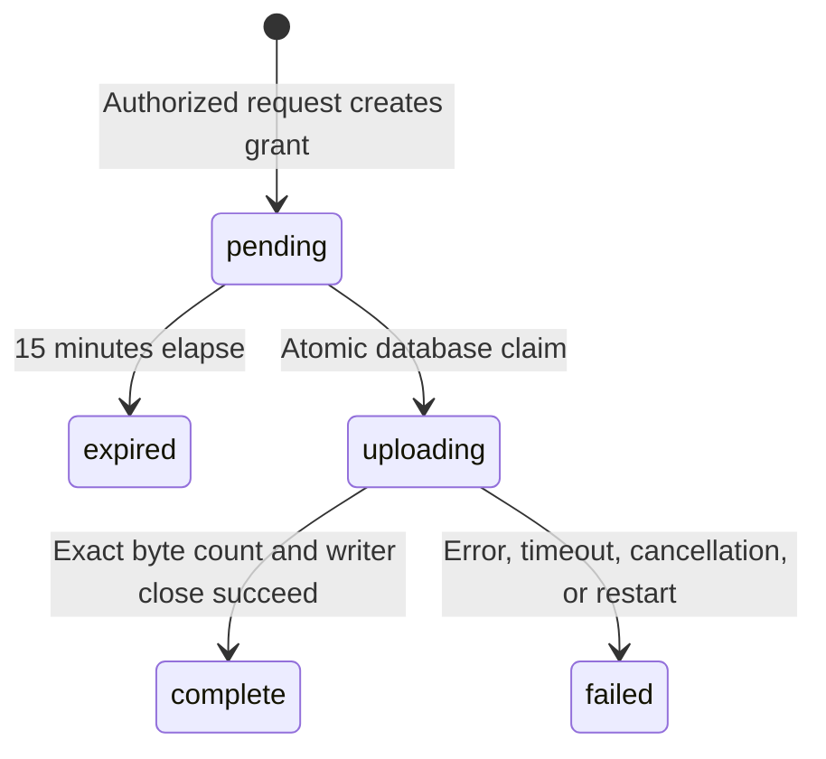

# Architecture

[← README](../README.md)

Rocket Cargo keeps storage concerns out of individual applications. Applications own their users and authorization decisions; Rocket Cargo owns upload grants, byte transfer, and the mapping from a project to its storage connection.

## Components

- **Axum** serves the REST API and embedded HTML/JavaScript dashboard. Assets are compiled into the binary.
- **SQLite** stores connection definitions, projects, hashed keys, and upload metadata. Foreign keys are enabled and the database uses WAL mode. Small synchronous queries are serialized through a mutex; no database lock is held during a storage transfer. This is deliberately a single-instance design, not a high-throughput database architecture.
- **OpenDAL** supplies filesystem, S3, Azure Blob, FTP, and SFTP adapters behind the same streaming interface.
- **Tokio** runs the HTTP server, storage I/O, transfer timeouts, and best-effort cleanup tasks.

## Upload lifecycle

Each grant contains a random 256-bit opaque token. Only its SHA-256 hash is stored. It is a preauthorized bearer URL rather than a provider-generated S3 signature. The record binds the grant to one project, backend, generated object key, content type, byte count, and expiry.

The transition to `uploading` uses a conditional SQLite UPDATE. If two clients present the same valid URL, only one can claim the pending row. Received bytes are counted while streaming; both short and oversized bodies fail. Completion is recorded only after the storage writer closes successfully.

The upload guard marks interrupted attempts failed and starts best-effort object deletion. A hard process stop can bypass cleanup, so startup marks leftover `uploading` records failed. The service cannot atomically commit a remote object and a SQLite row: a crash between those operations can leave an unreferenced or partial object. Provider lifecycle policies should remove abandoned multipart uploads.

## Isolation and trust

Object keys take the form `{project_id}/{upload_id}`. Caller-supplied filenames are metadata only, which prevents path traversal through filenames. Metadata and download queries require the owning project's key. IDs are UUIDs; project keys and upload tokens use 32 random bytes.

The admin token can configure filesystem locations and remote endpoints. Administrators are trusted operators with access comparable to the service user. Project keys authorize their project, not backend management. Storage credentials are read from named server environment variables when an adapter is constructed.

Downloads use attachment disposition and a generic content type. The dashboard uses text nodes for dynamic values and serves a restrictive Content Security Policy. Admin tokens remain in tab memory rather than browser storage.

## Resource limits

Uploads use an 8 MiB writer chunk target, at most 16 concurrent transfers, and a five-minute total transfer timeout. Buffering and protocol overhead depend on the adapter; this is not a strict process-wide memory ceiling. Downloads stream through OpenDAL but do not currently share the upload concurrency limiter.

There is no project-wide storage quota, rate limiter, or metadata retention task. Deployment-level limits remain the operator's responsibility.

## Why proxy uploads?

A cloud-only service could return native provider URLs and keep file bytes off its own network. Local folders, FTP, and SSH do not offer a matching mechanism. Proxying creates one predictable API and lets the service enforce byte counts across all backends, at the cost of bandwidth and an extra network hop.

The service intentionally avoids accounts, a frontend toolchain, a message queue, and a separate database server. If a deployment needs horizontal scaling or high request volumes, the SQLite model and synchronous control-plane queries should be revisited first.
